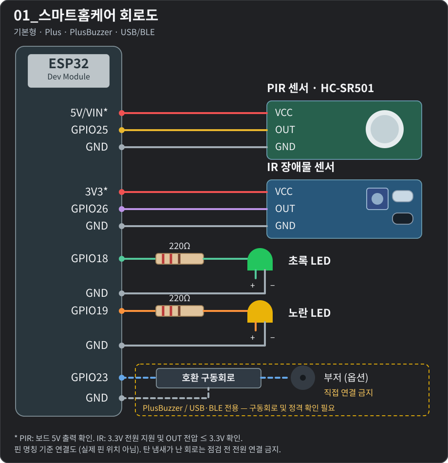

# 01_스마트홈케어 — PIR/IR 센서 실습

## 회로도

위 그림은 실제 기판 핀 배치가 아닌 코드의 논리적 배선도입니다. 점선 부저 회로는 정격과 구동 조건을 확인하기 전 연결하지 마세요.

**run.cmd**만 실행하면 Arduino IDE/CLI, ESP32 Core, CP210x, Python 및 USB/BLE 라이브러리를 준비한 뒤 예제 선택 메뉴를 엽니다. 00번 폴더는 필요 없습니다. 이미 설치된 도구는 재사용합니다. 예제 선택 후 Arduino IDE에서 ESP32 Dev Module과 실제 COM 포트를 선택해 수동 업로드합니다. 시리얼 모니터: 115200 baud.

메뉴 1~4는 각 Arduino 스케치를 열고, 5는 USB/BLE PC 화면, 6은 BLE 전용 PC 화면입니다. PC 화면은 메뉴 4의 스케치를 먼저 업로드하고 시리얼 모니터를 닫은 뒤 실행합니다.

- 기본형: `sketches/SmartHomeCare/SmartHomeCare.ino`
- Wi-Fi 및 부저 버전: 아래 링크
- USB/BLE: [esp32-dual-connection](esp32-dual-connection/)

## GPIO 연결

| 장치 | ESP32 GPIO | 기능 |
|---|---|---|
| HC-SR501 PIR OUT | 25 | HIGH일 때 움직임 감지로 처리 |
| IR 장애물 센서 OUT | 26 | LOW일 때 장애물 감지로 처리 |
| 녹색 LED | 18 | PIR 상태 |
| 노란색 LED | 19 | IR 상태 |

ESP32 GPIO에 5V를 직접 입력하면 손상 위험이 있습니다. 전원/신호 전압, 공통 GND, LED 전류 제한 저항을 확인하세요. 이 코드는 센서 상태 확인용이며 실제 낙상/울음 위험 탐지 기능은 구현하지 않았습니다.

## 제한 사항

- **Docker는 설치하지 않습니다.** 학교 PC에서 Arduino IDE/CLI를 직접 사용합니다.
- 컴퓨터 초기화 시 도구를 다시 내려받아야 할 수 있습니다.
- 학교 네트워크, PC 정책 또는 드라이버 권한에 따라 설치가 실패할 수 있습니다.
- 실제 학교 PC에서 스크립트 전체가 성공하는지는 아직 검증되지 않았습니다.

공식 자료: [Arduino IDE](https://github.com/arduino/arduino-ide/releases), [Arduino CLI](https://github.com/arduino/arduino-cli/releases), [ESP32 Core](https://docs.espressif.com/projects/arduino-esp32/en/latest/installing.html), [CP210x](https://www.silabs.com/software-and-tools/usb-to-uart-bridge-vcp-drivers).

## 추가 기능 — SmartHomeCarePlus

기존 코드에 더해 ESP32의 자체 Wi-Fi로 **스마트폰 웹 대시보드, PIR/IR 감지 횟수, 최근 12개 이벤트 기록, 동시 감지 주의 알림**을 확인하는 별도 예제를 추가했습니다. 원본 코드는 삭제하거나 변경하지 않았습니다.

- 코드: [`sketches/SmartHomeCarePlus/SmartHomeCarePlus.ino`](sketches/SmartHomeCarePlus/SmartHomeCarePlus.ino)
- 사용법: [`sketches/SmartHomeCarePlus/README.md`](sketches/SmartHomeCarePlus/README.md)
- run.cmd의 메뉴 2에서 PLUS를 열고 Arduino IDE에서 컴파일/업로드합니다.
- PLUS 스마트폰 연결: `HomeCare-ESP32` / `homecare2026` → `http://192.168.4.1` (교실 시연용 공개 기본 비밀번호)
- 동시 센서 감지는 실제 사고나 위험을 판정하지 않으며, 학습용 상태 표시입니다.

## 2핀 부저 경보 확장 예제

- [SmartHomeCarePlusBuzzer.ino](sketches/SmartHomeCarePlusBuzzer/SmartHomeCarePlusBuzzer.ino): PIR+IR 동시 감지 시 부저 경보를 발생시키고 웹의 주의 알림 확인 전까지 유지합니다.
- [2핀 부저 종류별 연결·설정 안내](sketches/SmartHomeCarePlusBuzzer/README.md): 액티브/패시브 부저 판별 및 구동 회로 주의사항. 부저 정격 확인 전 GPIO에 직접 연결하지 마세요.
- 기존 `SmartHomeCarePlus.ino`는 변경하지 않았습니다. run.cmd 메뉴 3에서 Arduino IDE로 컴파일/업로드할 수 있습니다.
